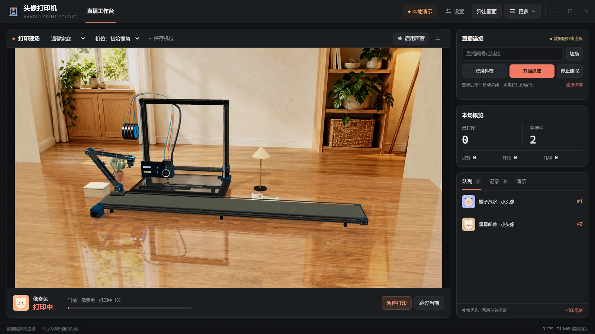
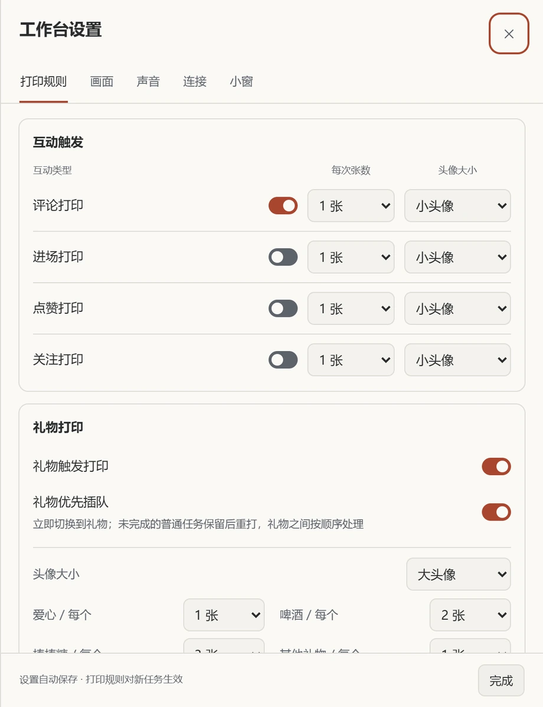
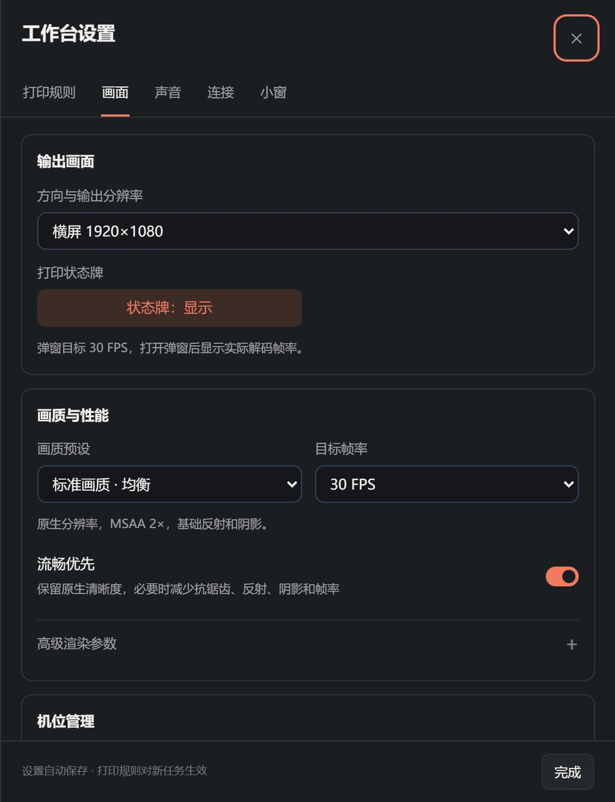
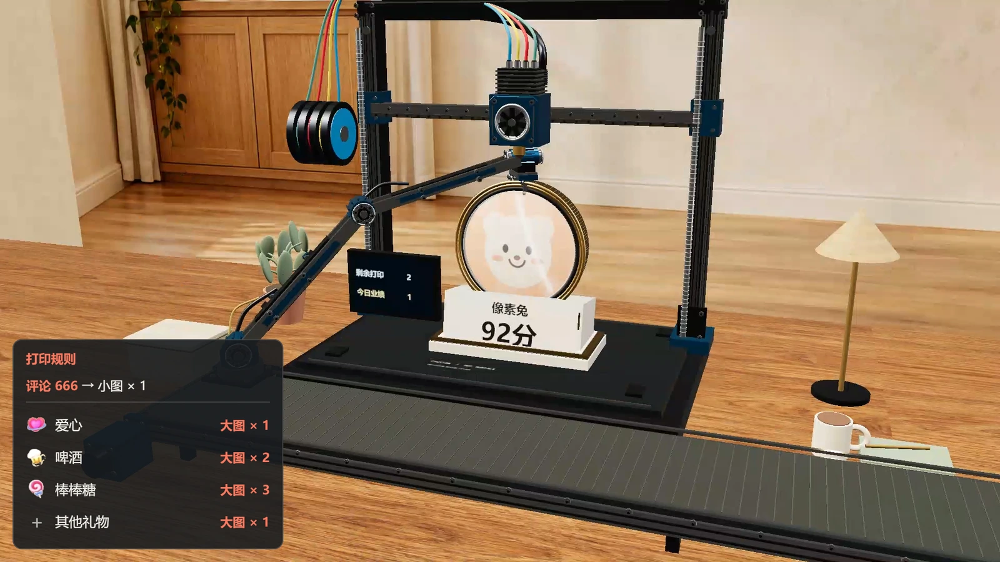

# 头像打印机

用于抖音直播互动的 3D 头像打印工作台：接收评论、进场、点赞、关注和礼物事件，将符合规则的观众头像加入打印队列，逐层成形、展示娱乐评分，再由机械臂转运到传送带。

**默认采用轻量 WSS 直连采集。** 登录只使用临时窗口，凭据成功保存后窗口自动关闭；采集在后台运行，无需常驻抖音直播网页、外部 Chrome 或直播伴侣。工作台和独立输出画面仍由 WebView2 渲染。

## Windows 免安装桌面包

完整解压 `dist/AvatarPrinter-Windows-x64.zip`，双击其中的 `AvatarPrinter.exe`。桌面包自带 Python、Node.js 和应用运行依赖，使用者无需执行 `npm ci` 或另行安装 Python、Node.js；系统需要 Windows 10 / 11（64 位）及 Microsoft Edge WebView2 Runtime。

请保留 EXE 同目录的 `app`、`runtime`、`_internal` 文件夹，并放在可写入的位置。发行包仅包含运行资源，不包含开发机的登录凭据、观众缓存、房间号或日志；首次接入时请在程序中完成登录。

## 快速接入直播

1. 在右侧「直播连接」填写直播间号或 `https://live.douyin.com/房间号`，点击「切换」。
2. 首次使用点击「登录抖音」，在临时窗口中自行完成扫码或验证。成功保存后，登录窗口自动关闭；已有有效登录时可直接开始抓取。
3. 点击「开始抓取」，在「连接详情」分别查看本地数据服务与后台采集状态。**数据服务连通仅代表本地桥已连接，后台采集显示「正在采集」才表示已接入直播间。** 保存了有效登录和房间号时，程序也可在启动时恢复后台采集。
4. 在「设置 → 打印规则」选择需要参与的互动类型、每次张数与头像大小。修改自动保存，对新收到的任务生效；已排队任务保持原设置。
5. 在「设置 → 画面」选择横竖屏与输出分辨率，再点击「弹出画面」。OBS 或直播伴侣的窗口采集选择「直播小窗 · Avatar Printer」。直播伴侣仅是可选的画面采集工具，不参与弹幕采集，也不需要安装其插件。

登录状态失效时，请主动点击「登录抖音」重新登录。取消、超时或连接错误不会自动反复打开登录窗口。「停止抓取」停止后台采集；关闭登录窗口不影响已经启动的采集。关闭主程序会清理本程序启动的采集进程和临时登录窗口。

不连接真实直播间也可使用右侧「演示」测试观众、互动事件、打印速度与头像导入。首次播放声音时点击顶部「启用声音」；音效和互动播报可分别设置，主动关闭后不会因普通页面点击自动恢复。

## 工作台与输出

- 单屏布局：左侧打印现场与暂停/跳过，右侧直播连接、本场概览和队列/记录/演示标签。打印规则、画面、声音、连接与小窗设置集中在设置抽屉中；支持中文和 English 界面。
- 打印规则默认开启评论与礼物打印；进场、点赞、关注可独立开启。默认爱心、啤酒、棒棒糖分别生成 1、2、3 张大头像，其他礼物默认 1 张；实际数量、大小及礼物优先均以设置为准。
- 独立小窗镜像主窗口的渲染，打印与声音继续由主窗口控制。小窗连接后主界面收起重复预览，关闭小窗后恢复；小窗保留系统标题栏，画面按比例铺满内容区域，不显示设计稿的返回按钮或说明角标。
- 「设置 → 小窗」可独立控制置顶、等待队列、互动规则、当前任务与本场统计。四个信息面板支持九宫格位置、水平/垂直微调、背景不透明度与 60%–160% 整体缩放；规则面板空间不足时自动缩小以完整显示内容，保存的缩放偏好不变。
- 互动规则牌按已开启的评论、进场、点赞、关注与礼物配置显示，保留原礼物 PNG。头像优先使用协议消息中的公开资料，缺少照片时显示彩色首字，后续互动可更新；不保证每个观众都能立即取得头像。
- 评分为 60–95 的娱乐随机分。程序读取公开互动，不代发弹幕、点赞或赠送礼物。

默认输出为 1080p、标准画质、30 FPS。流畅优先保持至少原生渲染分辨率，负载较高时先减少反射、阴影和抗锯齿开销，再调整目标帧率。静态合批、几何复用、头像缩图和有界队列用于控制长期资源开销。底部 MiB 仅为主离屏渲染缓冲估算，不能作为整个进程的内存统计。

主窗口默认 1280×720；独立小窗默认横屏 960×540、竖屏 405×720，并按屏幕工作区和 DPI 限制显示尺寸。窗口尺寸与源视频分辨率独立，切换同方向的 720p/1080p 不会把窗口放大到输出像素尺寸。

## 从源码运行

在项目根目录准备 Python 3.11、Node.js 22+ 和 WebView2 Runtime，再安装当前项目的锁定依赖：

```powershell
npm ci
python -m pip install -r requirements-desktop.txt
python launch.py
```

`package.json` 没有 `npm start`；Node 由桌面启动器按需管理。`start.bat` 会使用系统 `python`，找不到时尝试 `py -3`，启动 `launch.py`；`start-all.bat` 只是调用 `start.bat`，不会默认打开两个常驻窗口。请确保该 Python 环境已安装上述依赖。

需要指定初始房间与采集请求时，可用：

```powershell
python launch.py --room 123456789 --capture
```

这个命令仍要求先保存有效登录；缺少或失效的凭据会提示重新登录，不会改走常驻浏览器采集。只想启动本地 HTTP 服务时可用 `python launch.py --server-only`，然后访问启动器输出的地址；默认从 `http://127.0.0.1:8080/` 开始选择可用端口。请通过 HTTP 运行，不要直接双击 HTML 文件。

帮助中心位于 `help.html`，也可从工作台「更多 → 帮助与教程」打开内嵌帮助。`features.html` / `guide.html` 会跳转到对应帮助章节。

## 采集模式与旧兼容链路

`douyin-bridge.mjs` 默认选择 `PRINTER_COLLECTOR=lightweight`，直连抖音 WSS 并解析消息；桌面「登录抖音 / 开始抓取」走共用的轻量采集控制器。`start-bridge.bat` 是手动运行 Node 数据桥的辅助脚本，等价于 `node douyin-bridge.mjs [房间号]`，不会代替桌面的安全登录与凭据读取流程。

旧浏览器兼容实现仅在**手动启动数据桥并显式设置** `PRINTER_COLLECTOR=browser` 时启用，例如用于诊断旧采集链路：

```powershell
$env:PRINTER_COLLECTOR = "browser"
node douyin-bridge.mjs 123456789
Remove-Item Env:PRINTER_COLLECTOR
```

该兼容路径可能启动或连接调试浏览器，需要保留对应直播页面。桌面按钮仍使用轻量控制器，不会因连接错误自动降级到浏览器模式。当前桌面服务探测也只接受本应用的轻量采集进程，不能把手动兼容进程在线当作桌面采集已连接。

## 验证范围

从项目根目录运行自动化测试。

- `npm test` 运行 [Node.js 测试](tests/node)，覆盖事件映射、礼物连击、渲染和界面状态。
- `python -m unittest discover -s tests/python -t .` 运行 [Python 测试](tests/python)，覆盖桌面窗口、采集生命周期与打包。

[手动联调脚本](tests/manual)包含浏览器小窗、WebView2 输出和直播 WebSocket 诊断。运行小窗联调前需关闭正在运行的桌面版。WebView2 联调命令为 `python -m tests.manual.test_native_output`。

**本次集成不代表已验证真实直播间礼物完整性或长时间在线稳定性**；这些仍需在实际直播间、有效登录与不同网络环境下检查。当前版本不会承诺所有账号和直播间都能收到完全一致的公开事件。

## 界面预览

<video src="https://qny.luckyblank.cn/avatar-printer-promo.mp4" controls preload="metadata" width="100%"></video>

[打开《头像打印机》宣传片（36.8 秒，1080p）](https://qny.luckyblank.cn/avatar-printer-promo.mp4)

### 直播工作台



### 打印规则与画质设置

<p align="center">
  
  
</p>

### 独立直播小窗



## 构建 Windows 桌面包

在 Windows 构建机准备 Python 3.11 和 Node.js 22+，先安装 Node 依赖，再执行：

```powershell
npm ci
python -m venv .build-venv
.\.build-venv\Scripts\python.exe -m pip install -r requirements-desktop.txt
.\.build-venv\Scripts\python.exe build_desktop.py
```

构建输出为 `dist/AvatarPrinter/` 与 `dist/AvatarPrinter-Windows-x64.zip`。包内 `build-manifest.json` 记录依赖版本和文件校验值，`使用说明.txt` 提供启动及排错步骤。构建与分发不得包含本机登录数据、浏览器 profile、观众缓存或诊断日志。
